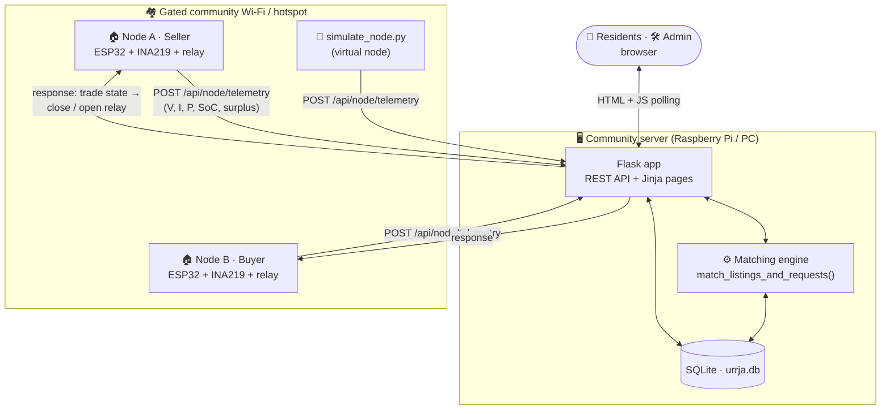
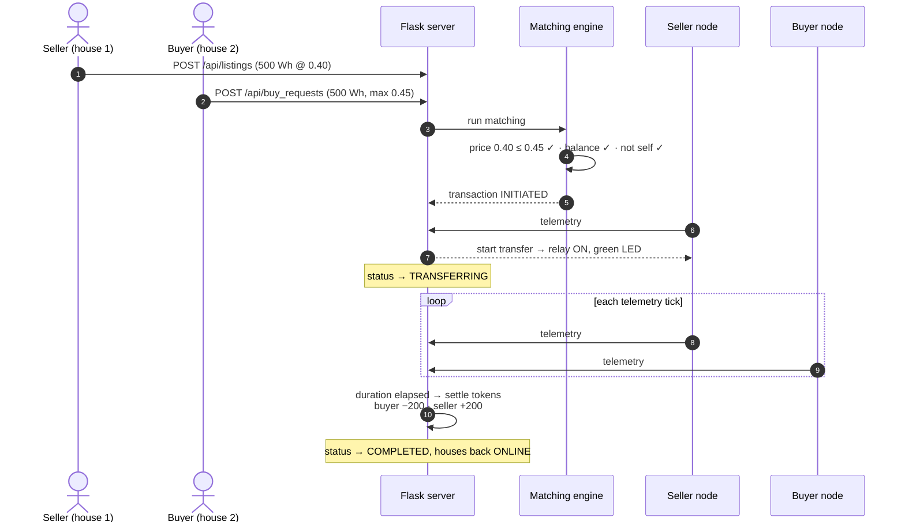
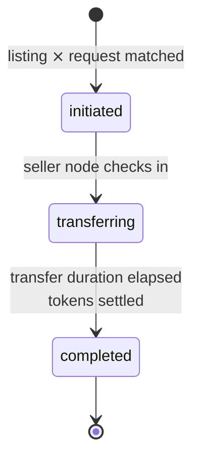
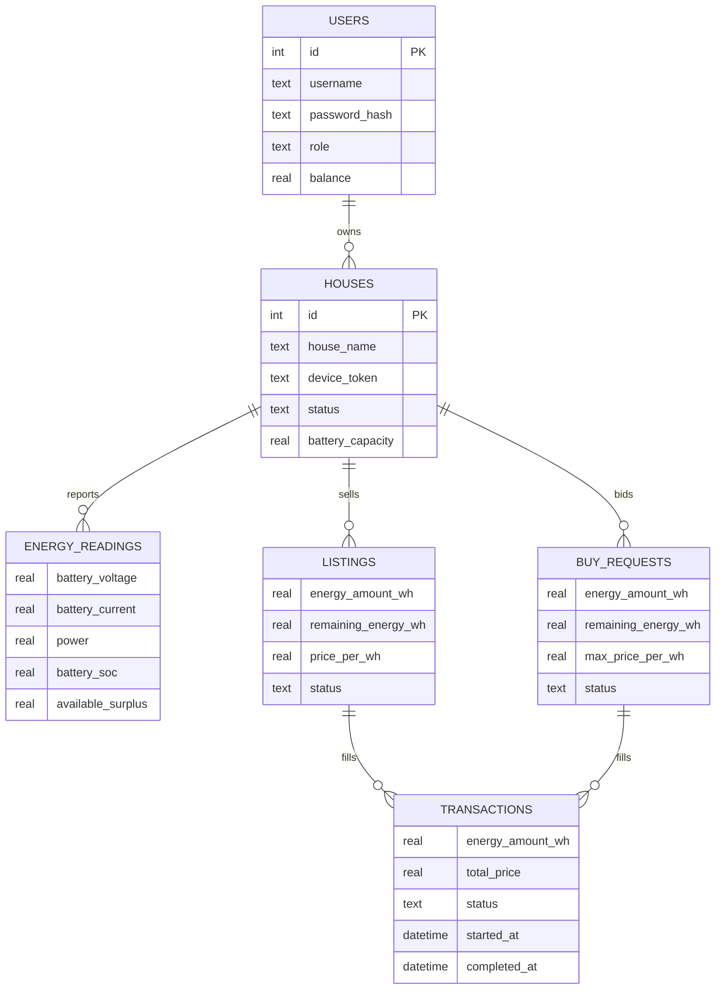
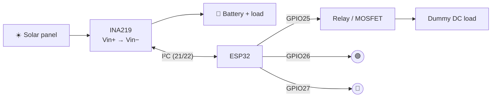

<div align="center">

# ☀️ URRJA: Peer‑to‑Peer Solar Energy Trading

**A neighbourhood marketplace for rooftop solar.**
Each home in a gated community runs an ESP32 energy node. A Flask server matches surplus sellers with buyers, switches the transfer on, and settles the trade in community tokens.


</div>

---

## ✨ Highlights

- ⚡ **Automated P2P matching engine**: cheapest listings meet the highest bids first, with partial fills, a self‑trade block and buyer balance checks
- 📡 **ESP32 smart nodes** read battery voltage, current and state of charge from an INA219 sensor, POST telemetry over HTTP, and close a relay while a trade is active
- 🔁 **Trade lifecycle** `initiated → transferring → completed`, driven by node telemetry, with token settlement on completion
- 📊 **Seven‑page web app**: dashboard with a state‑of‑charge dial, seller listings, marketplace, device monitor, ledger and admin console
- 🧪 **No hardware needed to try it**: `simulate_node.py` stands in for an ESP32, and `SIMULATION_MODE` fakes sensor readings on a real board

## 🏗️ System Architecture



## 🔄 Trade Lifecycle





### Matching rules

| # | Rule |
|:-:|------|
| 1 | Listings are sorted **cheapest first**, buy requests **highest bid first**, then oldest first (price–time priority) |
| 2 | A house can't trade with itself |
| 3 | A trade happens only when `seller price ≤ buyer max price`, and it settles at the **seller's price** |
| 4 | Quantity = `min(remaining listing, remaining request)`, so partial fills keep the leftover open |
| 5 | If the buyer can't afford the trade, the request is **cancelled** and a warning is logged |

## 🗄️ Data Model



A separate `logs` table records server and node events for the admin console.

## 🧰 Tech Stack

| Layer | Technology |
|------|-----------|
| Backend | Python 3.10+, Flask, Werkzeug (password hashing), SQLite |
| Frontend | Jinja2 templates, hand‑written CSS (custom properties, transitions), vanilla JavaScript (REST + polling) |
| Firmware | Arduino C++ on ESP32 (core v2.x / v3.x), `HTTPClient`, ArduinoJson, Adafruit INA219 |
| Hardware | ESP32‑WROOM‑DA, INA219 high‑side current sensor, 5 V relay / MOSFET switch, status LEDs, 5 A fuse |
| Simulation | `simulate_node.py` (Python `requests`) |

## 🔌 Hardware

| ESP32 pin | Connects to | Purpose |
|---|---|---|
| **GND** | GND | Common ground |
| **GPIO 21 (SDA)** | INA219 SDA | I²C data |
| **GPIO 22 (SCL)** | INA219 SCL | I²C clock |
| **GPIO 25** | Relay IN | Switches the simulated transfer load |
| **GPIO 2** | Built‑in LED | Wi‑Fi (blinking = connecting, solid = online) |
| **GPIO 26** | Green LED | Trade active |
| **GPIO 27** | Red LED | Sensor or server error |



## 🚀 Getting Started

### 1. Run the server

```bash
git clone https://github.com/arsheen2244/SolarEnergyTradingPlatform.git
cd SolarEnergyTradingPlatform/server
pip install flask requests werkzeug
python database.py      # optional: creates and seeds urrja.db (also runs on startup)
python app.py           # serves http://0.0.0.0:5000
```

### 2. Flash an ESP32 (optional)

1. In the Arduino IDE, install **Adafruit INA219** and **ArduinoJson**.
2. Open `esp32_firmware/esp32_firmware.ino` and set `ssid`, `password` and `serverUrl` (your server's LAN IP).
3. Without sensors, keep `#define SIMULATION_MODE 1`. Then flash the board.

### 3. Try a trade without hardware

| Seeded account | Username | Password |
|--------------|----------|----------|
| Admin | `admin` | `admin123` |
| Home owner | `house1_owner` | `urrja123` |

1. Run `python simulate_node.py` (it uses the seeded `token_node_101`) or `python simulate_node.py <device_token>` for a node you registered.
2. As `house1_owner`, list **500 Wh @ 0.40 tokens/Wh**.
3. In an incognito window, as `house2_owner`, bid **500 Wh, max 0.45 tokens/Wh**.
4. The simulator prints `[ACTIVE TRANSFER]`. Open `/admin` to watch `initiated → transferring → completed` and the wallet balances settle.

> These are local demo accounts. Change them before running the server on any shared network.

## 📁 Project Structure

```
SolarEnergyTradingPlatform/
├── esp32_firmware/
│   └── esp32_firmware.ino     # sensor read · telemetry POST · relay/LED control
└── server/
    ├── app.py                 # Flask routes, REST API, matching engine, settlement
    ├── database.py            # schema + seed data
    ├── simulate_node.py       # virtual ESP32 node
    ├── static/{css,js}/       # design system + polling/forms
    └── templates/             # base, login, dashboard, seller, marketplace,
                               # devices, transactions, admin
```

## ⚠️ Safety & Limitations

- This is a **low‑voltage prototype**. It never switches mains electricity (110/220 V AC).
- The relay only drives a small DC dummy load (LED, fan, resistor) to show that a trade has started.
- A real deployment would send this signal to a battery management system or a microgrid controller on a dedicated DC bus.
- Tokens are an internal ledger, not real currency.

---

<div align="center">Built by <a href="https://github.com/arsheen2244">Arsheen Inamdar</a></div>
